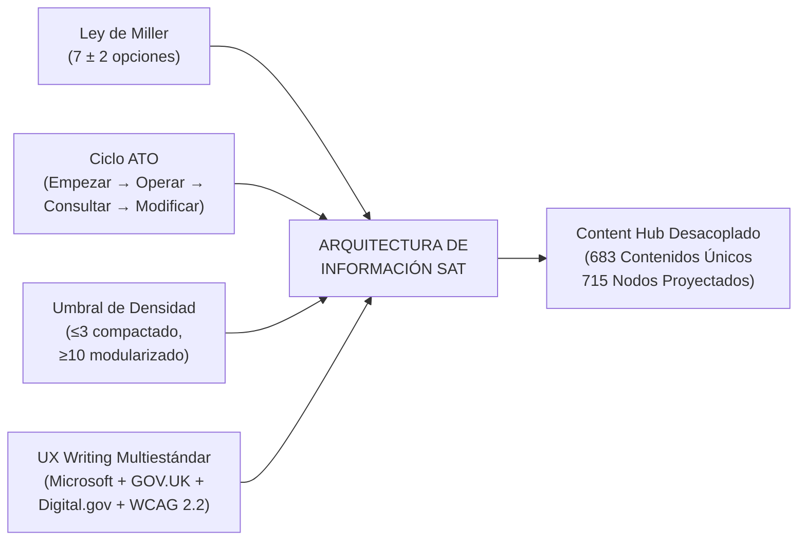

# Dossier Ejecutivo: Arquitectura de Información y Manual de UX Writing Institucional
## Portal Web — Superintendencia de Administración Tributaria (SAT Guatemala)

**Versión del Entregable:** 2.0 (Canónica)  
**Fecha:** Octubre 2026  
**Audiencia:** Directorio SAT, Intendencia de Atención al Contribuyente, Intendencia de Aduanas, Gerencia de Informática.  
**Estado:** Auditado al 100% (Metodología, Datos, Accesibilidad y Entregables en Sincronía).

---

## PARTE I: RESUMEN EJECUTIVO PARA AUTORIDADES

### 1. Diagnóstico del Portal Previo y Necesidad de Transformación
El portal institucional de la SAT acumulaba fricciones estructurales derivadas de un crecimiento orgánico:
1. **Dispersión y Redundancia:** Coexistían más de 700 páginas con títulos burocráticos, duplicidades de contenido entre áreas y estructuras "espejo" que obligaban a mantener el mismo trámite en múltiples lugares.
2. **Navegación Friccional (Sobre-andamiaje):** Ramas monocatenarias con hasta 5 niveles para llegar a opciones con solo 2 elementos (ej. *OEA > Programa OEA > OEA*), provocando fatiga de navegación y abandono.
3. **Lenguaje Técnico-Normativo:** Nombres centrados en leyes y acuerdos en lugar de responder a la tarea ciudadana (*"Decreto 27-92"* en lugar de *"Declarar y pagar IVA"*).
4. **Acoplamiento de Datos:** Ausencia de un identificador inmutable independiente del árbol de navegación.

### 2. Principios y Metodología Aplicada

* **Capacidad de Miller ($7 \pm 2$):** Ningún menú o contenedor satura la memoria operativa. Los menús agrupan entre 4 y 9 opciones; los nodos con $>9$ se modularizan por ciclo de vida o actor.
* **Regla de Umbral de Densidad ($A, A_1, A_2$ con umbral $\le 3$):** Sub-densidades ($\le 3$ gestiones terminales) se compactan al nivel superior, erradicando carpetas y pantallas vacías. Ramas densas ($\ge 10$) retienen jerarquía profunda (N4/N5).
* **Ciclo ATO (Australian Taxation Office):** El ordenamiento mental no usa números quemados en títulos, sino fases institucionales universales: *1. Empezar y registrarse $\to$ 2. Operación y declaraciones $\to$ 3. Consultas y herramientas $\to$ 4. Modificaciones y cierre $\to$ 5. Normativa y asistencia*.
* **Código Institucional Inmutable (`SAT-GES-####`):** 683 contenidos soberanos identificados universalmente desde `SAT-GES-0001` hasta `SAT-GES-0683`, garantizando trazabilidad y analítica omnicanal.

### 3. Métricas Clave de la Arquitectura Consolidada

| Indicador | Antes (Línea Base) | Después (Arquitectura Oficial) | Impacto Institucional |
| :--- | :---: | :---: | :--- |
| **Pilar 1: Contribuyentes** | 350+ enlaces dispersos | **344 gestiones** en 4 regímenes | Acceso directo por perfil fiscal sin ambigüedades. |
| **Pilar 2: Comercio Exterior** | 12 categorías planas | **245 gestiones** en 6 ramas | Estructura unificada bajo CAUCA/RECAUCA; 12 brechas normativas identificadas. |
| **Pilar 3: Profesionales** | Servicios aislados | **47 gestiones** en 5 roles | Espacio exclusivo para abogados, contadores, auditores y gestores. |
| **Pilar 4: Entes Exentos** | Trámites invisibles | **79 gestiones** en 5 regímenes | Fichas específicas para ONGs, Estado, Iglesias y Universidades. |
| **Contenidos Únicos (Content Hub)** | N/A (duplicados) | **683 contenidos canónicos** | 17 transversales proyectados a 715 nodos (32 proyecciones multi-audiencia). |
| **Enlaces Caídos / Home (`/`)** | Múltiples 404 / raíz | **0 rotos (100% URLs funcionales)** | Garantía de resolución inmediata en portal oficial. |
| **Accesibilidad Digital** | Variable | **WCAG 2.2 AA (axe-core 0 violaciones)** | Interfaz 100% operable por teclado, lectores de pantalla y contraste alto. |

---

## PARTE II: GUÍA EDITORIAL Y RECURSOS OFICIALES DE UX WRITING

Integración tripartita de estándares globales adaptados a la administración pública tributaria de Guatemala:
1. **Microsoft Writing Style Guide & Windows Apps Design:** Consistencia de interfaz, contenido escaneable, estados de error y accesibilidad universal.
2. **GOV.UK Service Manual:** Escritura basada en tareas ciudadanas y diseño de contenidos de servicio público.
3. **Digital.gov (Plain Language):** Principios legales de lenguaje claro y reducción de barreras de comprensión.

### 1. Referencias Oficiales Obligatorias de Microsoft Consultadas
* **Microsoft Writing Style Guide:** [https://learn.microsoft.com/en-us/style-guide/](https://learn.microsoft.com/en-us/style-guide/)
* **Writing style for Windows apps:** [https://learn.microsoft.com/en-us/windows/apps/design/style/writing-style](https://learn.microsoft.com/en-us/windows/apps/design/style/writing-style)
* **Scannable content:** [https://learn.microsoft.com/en-us/style-guide/scannable-content](https://learn.microsoft.com/en-us/style-guide/scannable-content)
* **Writing for all abilities (Accessibility):** [https://learn.microsoft.com/en-us/style-guide/accessibility/writing-all-abilities](https://learn.microsoft.com/en-us/style-guide/accessibility/writing-all-abilities)

---

### 2. Matriz de Voz y Tono Institucional (Adaptación al Contexto SAT)

| Dimensión | Enfoque Global (Microsoft / GOV.UK) | Adaptación a SAT Guatemala | Lo que NUNCA debemos hacer |
| :--- | :--- | :--- | :--- |
| **Voz (Quién habla)** | Claro, conciso, humano, útil, confiable. | **Autoridad tributaria cercana y orientadora.** La SAT asume el rol de facilitar el cumplimiento y garantizar la certeza jurídica. | No sonar burocrático, punitivo, amenazante ni hermético. |
| **Tono (Cómo habla)** | Informal y conversacional en inglés (*"We'll help you"*). | **Formal institucional, respetuoso y directo.** En español de Guatemala se usa el trato respetuoso pero sin florituras ni arcaísmos (*«Solicita tu NIT»*, *«Presenta tu declaración»*, *«Consulta el estado»*). | No usar coloquialismos callejeros ni tuteo excesivamente familiar que reste formalidad tributaria. Tampoco formulismos virreinales (*«Téngase por enterado el impetrante»*). |
| **Enfoque de Servicio** | Centrado en el usuario, no en la organización. | **La gestión se describe desde la necesidad de la persona**, no desde la unidad administrativa interna de SAT (*«Inscribir una empresa»* en vez de *«Procedimiento normativo del Departamento de Registro Tributario»*). | No titular páginas con nombres de oficinas internas, códigos de ley huérfanos o resoluciones de directorio. |

---

### 3. Matriz Comparativa entre Marcos Metodológicos (Divergencias y Criterio SAT)

| Aspecto Editorial | GOV.UK | Microsoft Style Guide | Digital.gov | Criterio Canónico Adoptado en SAT |
| :--- | :--- | :--- | :--- | :--- |
| **Uso de Siglas** | Evitarlas siempre a menos que sean ultra conocidas (ej. NHS). | Expandir en la primera mención con paréntesis: `Palabra Completa (SIGLA)`. | Permitir siglas si el público objetivo es especializado. | **Criterio Microsoft/Digital.gov:** En la primera mención y títulos visibles se expande obligatoriamente: *Número de Identificación Tributaria (NIT)*, *Operador Económico Autorizado (OEA)*, *Declaración Única Centroamericana (DUCA)*. Quedan prohibidas las siglas huérfanas sin contexto. |
| **Títulos de Tareas** | Comenzar siempre con verbo en infinitivo (*"Renew your passport"*). | Comenzar con verbo de acción en imperativo o gerundio/infinitivo según jerarquía de UI. | Centrarse en el resultado que la persona busca obtener. | **Criterio GOV.UK + Microsoft:** Verbos de acción directa en infinitivo o imperativo institucional: *«Solicitar Número de Identificación Tributaria (NIT)»*, *«Habilitar libros contables»*, *«Pagar impuesto de circulación»*. Erradicada la palabra *"Trámite"*. |
| **Nivel de Lectura** | Nivel de lectura de 9 años (comprensión universal). | Nivel accesible, oraciones de menos de 25 palabras. | Plain Language Act: eliminar jerga legal y palabras complejas. | **Criterio Digital.gov + Microsoft:** Nivel accesible sin distorsionar la figura jurídica. Si el término legal es obligatorio por CAUCA/Código Tributario, se acompaña de una glosa operativa (*«Mandato especial con representación (carta poder autenticada)»*). |
| **Trato al Usuario** | Segunda persona directa (*"you"*). | Segunda persona directa (*"you"*). | Segunda persona directa (*"you"*). | **Segunda persona directa institucional en español:** *«Tu Agencia Virtual»*, *«Descarga tu constancia»*, *«Tus obligaciones»*. |

---

### 4. Estándares Aplicados por Componente de Interfaz

#### A. Contenido Escaneable (*Scannable Content* - Microsoft & GOV.UK)
1. **Modelo de Pirámide Invertida:**
   * La respuesta o acción principal se coloca en el primer tercio del párrafo.
   * Lead text explicativo de 1 o 2 oraciones (máximo 30 palabras) antes de cualquier listado de requisitos.
2. **Estructura en Listas con Viñetas:**
   * Cuando hay $\ge 3$ requisitos o pasos, se presentan en viñetas ordenadas o numeradas.
   * Cada elemento de la lista inicia con mayúscula y mantiene estructura gramatical paralela (todos con verbo o todos con sustantivo).
3. **Escaneo Visual (F-Pattern):**
   * Encabezados H2 y H3 claros y descriptivos. Prohibido usar encabezados genéricos como *"Información"* o *"Detalles"*. En su lugar: *«Requisitos para personas individuales»*, *«Pasos para presentar la gestión»*.

#### B. Redacción de Botones y Elementos Accionables (*Action-Oriented*)
* **Regla de Oro:** El botón debe indicar exactamente **qué pasará cuando la persona haga clic**.
* **Fórmula:** `[Verbo de Acción]` + `[Objeto Directo]` (si es necesario).
  * ❌ *Enviar*, *Aceptar*, *Hacer clic aquí*, *Procesar*.
  * ✅ *«Solicitar Agencia Virtual»*, *«Generar formulario SAT-2000»*, *«Descargar constancia de RTU»*, *«Consultar estado de trámite»*.
* **Capitalización:** Solo la primera letra en mayúscula (*Sentence case*), conforme a Microsoft Style Guide: *«Confirmar cita»* (no *«Confirmar Cita»*).

#### C. Mensajería de Error y Prevención de Fricción (*Error Handling*)
Basado en las 4 pautas de Microsoft y WCAG:
1. **Qué ocurrió:** Explicar el problema en lenguaje claro, sin tecnicismos ni códigos de error del servidor.
2. **Por qué ocurrió:** Dar la razón lógica sin culpar al usuario.
3. **Cómo resolverlo (Siguiente paso):** Proporcionar la acción correctiva inmediata.
4. **Dónde pedir ayuda:** Enlace o canal de soporte.

* **Ejemplo Práctico en SAT:**
  * ❌ *«Error 403: Objeto no encontrado o no tiene permisos en base de datos de RTU.»*
  * ✅ *«No pudimos validar tu NIT. Verifica que los dígitos estén completos y no contengan guiones. Si el problema continúa, consulta tu estado en el RTU Digital o contacta a soporte.»*

#### D. Accesibilidad y Escritura Universal (*Writing for All Abilities* - Microsoft & WCAG 2.2 AA)
* **Texto de Enlaces Autónomo:** Los hipervínculos deben tener sentido fuera de contexto. Prohibido enlaces que digan *"clic aquí"* o *"más información"*. En su lugar: *«Consulta los requisitos para traspaso vehicular en Agencia Virtual»*.
* **No depender de atributos sensoriales:** No escribir *«haz clic en el botón verde de la derecha»* o *«revisa la tabla de abajo»*. Usar identificación semántica: *«selecciona el botón Continuar»*.
* **Texto Alternativo en Gráficos e Íconos:** Descripciones textuales precisas que comuniquen la función, no la apariencia visual.
* **Contraste de Lenguaje:** Evitar dobles negaciones (*«No presentes la gestión si no has pagado»* $\to$ *«Paga el impuesto antes de presentar la gestión»*).

---

## PARTE III: GLOSARIO Y CONVENCIONES EDITORIALES SAT

| Término Erradicado / Prohibido | Término Canónico Aprobado | Razón Metodológica |
| :--- | :--- | :--- |
| **Trámite** | **Gestión** / **Servicio** | "Trámite" connota burocracia, obstáculo y retraso. "Gestión" orienta a la resolución activa y cumplimiento de un servicio público. |
| **Mi Primer NIT** | **Solicitar Número de Identificación Tributaria (NIT)** | Erradica la ambigüedad de que existe un "segundo NIT" y enfoca la ficha en la acción real que realiza el ciudadano por primera vez. |
| **OEA** (aislado) | **Operador Económico Autorizado (OEA)** | Cumple con la regla de cero siglas huérfanas; asegura comprensión ciudadana y técnica. |
| **AFPA** (aislado) | **Auxiliares de la Función Pública Aduanera (AFPA)** | Clarifica la figura jurídica aduanera establecida en CAUCA IV. |
| **ZDEEP** (aislado) | **Zonas de Desarrollo Económico Especial Público (ZDEEP)** | Otorga certeza jurídica y conceptual sobre regímenes territoriales especiales. |
| **RTU** (aislado) | **Registro Tributario Unificado (RTU)** | Establece el nombre oficial del padrón tributario nacional. |
| **FEL** (aislado) | **Factura Electrónica en Línea (FEL)** | Clarifica el ecosistema digital de emisión de comprobantes fiscales. |
| **1. Inscripción... 2. Declaración...** | **Inscripción... Declaración...** (sin números) | Prohíbe quemar números en títulos visibles. La gobernanza del orden se delega a las columnas técnicas `orden_n1..orden_n5` y al ciclo ATO. |

---

## PARTE IV: ESTADO DE VALIDACIÓN Y CONTROL DE CAMBIOS

1. **Gobernanza Automatizada:** 15 de 15 pruebas superadas en el script maestro `audit_entregables_completa.py`.
2. **Zero Fricciones Técnicas:** Compilación limpia en Vite/TypeScript (`npm run build`) y suite de pruebas de accesibilidad E2E de Playwright con 19 de 19 tests pasando al 100% bajo estándares axe-core WCAG 2.2 AA.
3. **Repositorio Central:** Confirmado en Git con commits trazables (`8e06ab1`, `a5956f1`, `79060f3`, `a46c5e4`, `a96ae35`).
