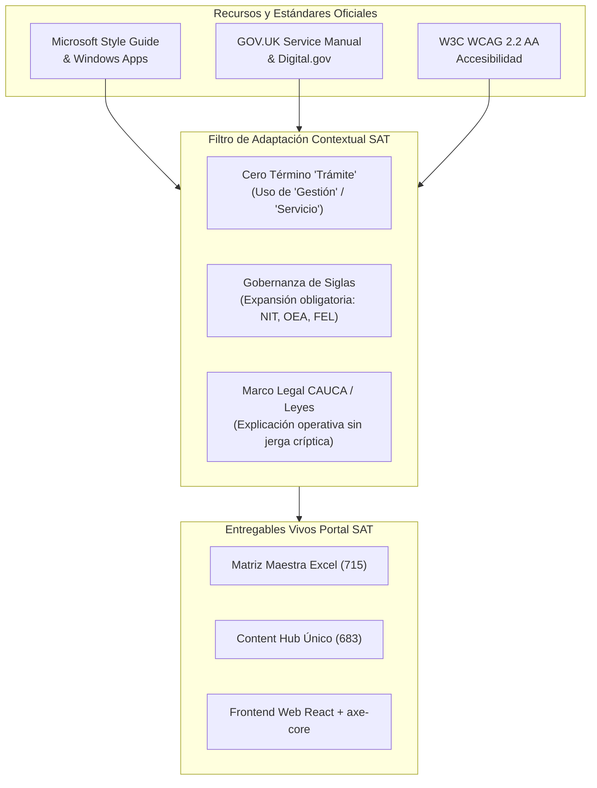

# Inventario Canónico de Recursos y Estándares de UX Writing
## Portal Web — Superintendencia de Administración Tributaria (SAT Guatemala)

**Propósito del Documento:** Servir como repositorio bibliográfico, normativo y técnico de consulta directa para diseñadores de contenido, redactores de interfaz (*UX Writers*), analistas de procesos y desarrolladores del Portal SAT.

---

## 1. RECURSOS OFICIALES DE MICROSOFT (CONSULTA OBLIGATORIA)

### 1.1 Microsoft Writing Style Guide (Guía Maestra)
* **URL Oficial:** [https://learn.microsoft.com/en-us/style-guide/](https://learn.microsoft.com/en-us/style-guide/)
* **Ámbito de Aplicación:** Estándar editorial global de redacción digital, tono, estilo, gramática y consistencia de terminología en software, plataformas web y documentación técnica.
* **Directrices Clave Aplicadas a SAT:**
  * **Sentence case (Uso de mayúsculas en oración):** Los títulos de páginas, encabezados de sección y etiquetas de botones solo llevan mayúscula inicial y en nombres propios (ej. *«Consultas y herramientas»*, *«Habilitación de libros contables»*). Prohibido el *Title Case* anglosajón (*«Consultas Y Herramientas»*).
  * **Global readiness (Comprensión internacional y neutralidad):** Evitar modismos locales que confundan a usuarios de distintos niveles socioculturales o extranjeros obligados tributarios en Guatemala.
  * **Contracciones y concisión:** Oraciones simples, preferentemente activas, con un promedio menor a 25 palabras por enunciado.

### 1.2 Writing Style for Windows Apps (Redacción de Interfaces y Aplicativos)
* **URL Oficial:** [https://learn.microsoft.com/en-us/windows/apps/design/style/writing-style](https://learn.microsoft.com/en-us/windows/apps/design/style/writing-style)
* **Ámbito de Aplicación:** Textos integrados en componentes interactivos: menús modales, diálogos de confirmación, campos de formulario (*labels*, *placeholders*, *helper text*) y notificaciones.
* **Directrices Clave Aplicadas a SAT:**
  * **Verbos orientados a la acción:** Los botones no confirman pasivamente (*«Aceptar»*, *«OK»*); describen la consecuencia de la acción (*«Crear usuario»*, *«Pagar impuesto»*, *«Descargar solvencia»*).
  * **Placeholders contextuales:** El texto de ayuda dentro de una caja de texto debe ser un ejemplo de formato válido (ej. *«Ej. 1234567-8»*), nunca una repetición del nombre del campo.
  * **Tratamiento de diálogos modales:** El encabezado del modal formula la pregunta o decisión principal (*«¿Deseas inactivar este establecimiento?»*); los botones ofrecen las respuestas directas (*«Inactivar establecimiento»* y *«Cancelar»*).

### 1.3 Scannable Content (Diseño de Contenido Escaneable)
* **URL Oficial:** [https://learn.microsoft.com/en-us/style-guide/scannable-content](https://learn.microsoft.com/en-us/style-guide/scannable-content)
* **Ámbito de Aplicación:** Estructura visual del texto para usuarios que leen en diagonal y buscan respuestas inmediatas en pantallas móviles y de escritorio.
* **Directrices Clave Aplicadas a SAT:**
  * **Patrón de lectura en F (F-Pattern):** Colocar los términos más informativos y relevantes al inicio de cada encabezado y de cada viñeta (*front-loading*).
  * **Lead text orientado al propósito:** Párrafos de entrada de máximo 2 líneas (30 palabras) que sintetizan para qué sirve la gestión antes de desplegar requisitos.
  * **Listas paralelas:** Todo listado de requisitos o pasos debe mantener consistencia morfosintáctica (si la primera viñeta inicia con verbo, todas inician con verbo).
  * **Bloques breves:** Ningún párrafo de explicación o fundamento normativo debe exceder las 3 o 4 líneas de texto visual.

### 1.4 Writing for All Abilities (Accesibilidad Universal y WCAG)
* **URL Oficial:** [https://learn.microsoft.com/en-us/style-guide/accessibility/writing-all-abilities](https://learn.microsoft.com/en-us/style-guide/accessibility/writing-all-abilities)
* **Ámbito de Aplicación:** Accesibilidad cognitiva, auditiva, motora y visual para garantizar autonomía de interacción a personas con discapacidad o bajo lectores de pantalla (*screen readers*).
* **Directrices Clave Aplicadas a SAT:**
  * **Hipervínculos descriptivos y autosuficientes:** Queda terminantemente prohibido el uso de enlaces vacíos (*«Haz clic aquí»*, *«Más información»*, *«Ver detalle»*). Todo enlace debe contener el destino explícito: *«Consulta los requisitos para autorización de imprentas»*.
  * **Independencia sensorial:** No redactar instrucciones dependientes de color, posición física o forma geométrica (*«Presiona el botón celeste de la derecha»* $\to$ *«Selecciona el botón Continuar»*).
  * **Legibilidad y contraste conceptual:** Evitar dobles negaciones que eleven la carga cognitiva (*«No omitas presentar»* $\to$ *«Recuerda presentar»*).

---

## 2. RECURSOS METODOLÓGICOS DEL SECTOR PÚBLICO DIGITAL

### 2.1 GOV.UK Service Manual (Diseño Orientado a Tareas Ciudadanas)
* **URL Oficial:** [https://www.gov.uk/service-manual/design/writing-for-user-interfaces](https://www.gov.uk/service-manual/design/writing-for-user-interfaces)
* **Guía de Estilo GOV.UK:** [https://www.gov.uk/guidance/style-guide/a-to-z-of-gov-uk-style](https://www.gov.uk/guidance/style-guide/a-to-z-of-gov-uk-style)
* **Directrices Clave Aplicadas a SAT:**
  * **Redacción basada en tareas (*Task-based design*):** Los ciudadanos acuden al portal a completar una obligación o ejercer un derecho, no a estudiar el organigrama de la SAT.
  * **Eliminación del lenguaje corporativo/burocrático:** Sustitución de terminología interna por el lenguaje natural del contribuyente.
  * **Un único punto de entrada para cada tarea:** Evitar la dispersión de requisitos en múltiples páginas; unificar la ficha de la gestión.

### 2.2 Digital.gov & Plain Language Action and Information Network (PLAIN)
* **URL Oficial:** [https://www.plainlanguage.gov/guidelines/](https://www.plainlanguage.gov/guidelines/)
* **Portal de Recursos Digital.gov:** [https://digital.gov/topics/plain-language/](https://digital.gov/topics/plain-language/)
* **Directrices Clave Aplicadas a SAT:**
  * **Voz activa en lugar de voz pasiva:** *«La SAT verificará tu documentación en 3 días hábiles»* en lugar de *«La documentación será verificada por la autoridad»*.
  * **Eliminación de palabras redundantes:** Redactar de forma concisa sin subordinadas innecesarias (*«Para poder solicitar»* $\to$ *«Para solicitar»*).
  * **Tablas informativas:** Cuando una regla tributaria depende de condiciones cruzadas (ej. tipo de contribuyente vs. régimen de IVA), presentarla en tabla comparativa simple en lugar de texto denso.

---

## 3. ESTÁNDARES TÉCNICOS DE ACCESIBILIDAD DIGITAL

### 3.1 W3C / Web Content Accessibility Guidelines (WCAG 2.2 AA)
* **URL Oficial:** [https://www.w3.org/TR/WCAG22/](https://www.w3.org/TR/WCAG22/)
* **Criterios Específicos de UX Writing Auditados en SAT:**
  * **Criterio 2.4.4 (Propósito de los enlaces en contexto):** Todo hipervínculo identifica su propósito claramente.
  * **Criterio 3.3.1 (Identificación de errores):** Si se detecta un error de entrada de datos, el elemento erróneo se identifica y el error se describe por escrito de forma explícita.
  * **Criterio 3.3.2 (Etiquetas o instrucciones):** Se proporcionan etiquetas legibles (*labels*) asociadas a cada control de formulario.
  * **Criterio 3.3.3 (Sugerencias ante errores):** El sistema propone la solución exacta para corregir el dato erróneo.

---

## 4. MATRIZ DE APLICABILIDAD Y ADAPTACIÓN EN EL CONTEXTO SAT

---

## 5. GUÍA RÁPIDA DE APLICACIÓN EN CASOS COMUNES DE INTERFAZ

| Escenario de Interfaz | Práctica Prohibida | Práctica Canónica Aprobada (Multi-estándar) | Estándar de Referencia |
| :--- | :--- | :--- | :--- |
| **Página de Inicio / Categoría** | Titular: *"Trámites del Régimen de Aduanas"* | Titular: **`Operaciones y Servicios Aduaneros`** | GOV.UK / SAT Policy |
| **Botón de Descarga** | Botón: *"Clic aquí"* | Botón: **`Descargar formulario SAT-2000`** | Microsoft / WCAG 2.4.4 |
| **Error en Formulario RTU** | *"Campo inválido: Caracteres no permitidos"* | *"Ingresa tu NIT sin espacios ni guiones (ej. 1234567-8)"* | Microsoft / WCAG 3.3.3 |
| **Siglas en el Título** | Titular: *"OEA para AFPAs en ZDEEP"* | Titular: **`Operador Económico Autorizado (OEA) para auxiliares aduaneros en Zonas Especiales (ZDEEP)`** | Microsoft Style / Digital.gov |
| **Instrucción de Ayuda** | *"Ver requisitos en el botón verde inferior"* | *"Selecciona Requisitos para conocer los documentos obligatorios"* | Microsoft Writing All Abilities |
| **Confirmación de Cita** | Botón: *"Aceptar"* | Botón: **`Confirmar cita presencial`** | Windows Apps Writing Style |
