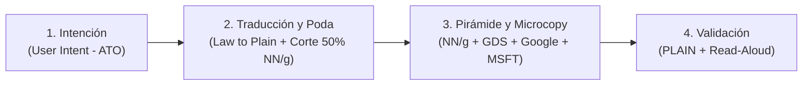

# Metodología Integral de Lenguaje Claro y UX Writing Tributario
## Estándar Operativo para Equipos Humanos: Núcleo ATO + Evidencia Empírica de Nielsen Norman Group (NN/g) + Prácticas de Microsoft, Google, UK GDS e ISO 24495-1

Esta metodología es la guía práctica de redacción, edición y validación de contenidos para el equipo humano (especialistas tributarios, redactores, analistas legales, diseñadores de contenido y comunicadores) del Portal SAT Guatemala.

---

## 1. El Marco Metodológico Internacional Integrado

Para lograr un portal con rigurosa certeza jurídica pero con usabilidad ciudadana intuitiva, articulamos tres dimensiones de excelencia:

```
┌─────────────────────────────────────────────────────────────────────────────┐
│                      ECOSISTEMA METODOLÓGICO SAT                            │
├───────────────────────┬──────────────────────────┬──────────────────────────┤
│   GOBIERNO FISCAL     │   CIENCIA Y USABILIDAD   │  INTERACCIÓN Y PRODUCTO  │
│      (Qué decir)      │    (Cómo lee el ojo)     │       (Cómo guiar)       │
├───────────────────────┼──────────────────────────┼──────────────────────────┤
│ 1. ATO (Australia):   │ 3. Nielsen Norman Group  │ 4. Microsoft Style Guide:│
│    "Lead with the     │    (NN/g):               │    Tono cálido, sin culpa│
│    need, not the law" │    • Regla del 79% escaneo│   y botones predecibles. │
│    y diseño en 3      │    • Corte del 50% texto │ 5. Google Material UX:   │
│    capas.             │    • Pirámide Invertida  │    Claro-Conciso-Útil,   │
│ 2. UK GDS (GOV.UK):   │    • Heurísticas 5 y 9   │    helpers preventivos y │
│    Front-Loading y    │      de errores.         │    Sentence Case.        │
│    Visual Chunking.   ├──────────────────────────┴──────────────────────────┤
│                       │ 6. ISO 24495-1:2023 (Plain Language)                 │
│                       │ 7. PLAIN Network (EE. UU.): Protocolo Read-Aloud.   │
└───────────────────────┴─────────────────────────────────────────────────────┘
```

---

## 2. Los Principios Rectores Integrados

### A. La Evidencia Científica de Nielsen Norman Group (NN/g)
1. **La Regla del 79% (El usuario no lee, escanea):**  
   Los estudios de *eye-tracking* de NN/g demuestran que el **79% de los usuarios escanea la pantalla** buscando pistas visuales; solo el 16% lee palabra por palabra. Escribir párrafos densos equivale a esconder la información.
2. **La Regla del Corte del 50% (Word Count Reduction):**  
   *«Escribe tu primer borrador. Luego recorta la mitad de las palabras. Luego revisa si puedes recortar otro tercio.»* (Jakob Nielsen). Cortar retórica de cortesía y rodeos administrativos aumenta drásticamente la comprensión y retención del contribuyente.
3. **La Pirámide Invertida Digital:**  
   - **Arriba (Conclusión inmediata):** ¿Qué es esto y qué debo hacer hoy?
   - **Al centro (Detalles operativos):** Requisitos en viñetas, plazos y costos.
   - **Al pie (Fondo normativo):** Artículos de leyes y decretos para quien desee auditar.
4. **Heurística 5 y 9 (Prevención y Recuperación ante Errores):**  
   - *Heurística 5 (Prevención):* Diseñar microcopys preventivos (ayudas antes de escribir) para que el error nunca ocurra.
   - *Heurística 9 (Manejo constructivo de errores):* Lenguaje humano sin códigos crudos (`Error 403`), indicando el problema exacto y ofreciendo la salida inmediata en un solo clic.

### B. El Núcleo ATO (Australian Taxation Office)
1. **"Lead with the need, not the law" (Empezar por la necesidad):**  
   El ciudadano entra a resolver una tarea concreta (*pagar, inscribirse, facturar, consultar*), no a estudiar leyes. El texto se organiza según el viaje del usuario, no según el organigrama ni los capítulos del código tributario.
2. **Layered Content (Contenido en 3 capas):**
   - **Capa 1 (Acción inmediata):** Lo esencial para actuar hoy (pasos directos, plazos y requisitos).
   - **Capa 2 (Soporte contextual):** Preguntas frecuentes, qué hacer si cambian los datos y ejemplos prácticos.
   - **Capa 3 (Certeza jurídica):** Acuerdos, leyes y decretos aislados al pie bajo la sección colapsable *"Base legal y normativa asociada"*.

### C. Los Aportes de Microsoft (Microsoft Writing Style Guide)
1. **Tono Cálido, Claro y Disposición de Ayuda:** Hablar con naturalidad, eliminando la frialdad judicial.
2. **Cero Culpa al Usuario (No-Blame Error Handling):** Prohibido culpar al usuario (*"Usted ingresó mal el dato"*). Se describe la situación y se brinda la solución:
   - ❌ *Ingresó un NIT inválido o inexistente.*
   - ✅ **El NIT necesita 8 dígitos. Revisa el número e intenta de nuevo.**
3. **Botones de Acción Predecibles (Actionable CTAs):** El texto del botón debe responder a: *¿Qué pasará si hago clic aquí?*
   - ❌ *Continuar*, *Procesar*, *Enviar*.
   - ✅ **Descargar calcomanía vehicular**, **Pagar en Declaraguate**, **Solicitar cita**.

### D. Los Aportes de Google (Material Design Content Guidelines)
1. **La Tríada de Google: Claro, Conciso y Útil:**
   - **Claro:** Lenguaje común de la calle.
   - **Conciso:** La versión más breve posible con significado completo.
   - **Útil:** Cada línea debe orientar una decisión o acción. Lo que no ayuda a actuar, se borra.
2. **Texto de Ayuda Preventivo en Formularios (Helper Text):**
   - *Etiqueta:* **Número de DPI**
   - *Texto de ayuda:* *Los 13 dígitos del Código Único de Identificación (CUI) de tu DPI, sin guiones ni espacios.*
3. **Uso de Sentence Case:**  
   Mayúsculas solo al inicio de la frase y en nombres propios o siglas. Mejora un 12% la velocidad de lectura.

### E. La Fragmentación de UK GDS (GOV.UK - Content Design)
- **Front-Loading:** Colocar el verbo de acción en las **primeras 3 a 5 palabras**.
- **Visual Chunking:** Requisitos en listas viñetadas breves. Cero párrafos continuos de más de 3 líneas.

---

## 3. Normativa Institucional Específica del SAT Guatemala

1. **Prohibición Absoluta de "Trámite" $\to$ Uso de "Gestión" / "Gestiones":**  
   Queda terminantemente prohibido usar la palabra *"trámite"* o *"trámites"*. Se utiliza **"gestión" / "gestiones"** o, preferentemente, el verbo de acción directa (*solicitar, emitir, pagar, actualizar*).
2. **Cero Acrónimos Huérfanos:**  
   Todo acrónimo tributario o aduanero debe expandirse en su primera mención: `Nombre Completo (SIGLA)`.
3. **Página Completa Dedicada (Cero Modales ni Popovers):**  
   Toda información de gestión o requisitos se consulta en su propia página completa con URL canónica `#/gestion/:id`.

---

## 4. El Proceso Operativo Paso a Paso para Equipos Humanos



### Fase 1: Identificar la Intención (User Intent)
Antes de redactar, define:
1. ¿Qué tarea viene a completar la persona?
2. ¿Qué documentos o datos debe tener a mano antes de empezar?
3. ¿Cuál es el error más frecuente y cómo se lo evitamos de forma preventiva (NN/g)?

### Fase 2: Traducir la Ley y Aplicar el Corte del 50%
Sustituye la jerga técnica y poda el texto eliminando palabras vacías:

| Expresión Legal o Burocrática | Término Ciudadano Aprobado |
| :--- | :--- |
| **Trámite / Trámites** | **Gestión / Gestiones** |
| *Sujeto pasivo / Contribuyente afecto* | **Personas y empresas con o sin negocio** |
| *Omisos tributarios* | **Pagos o declaraciones pendientes** |
| *Régimen de rentas del trabajo* | **Impuestos para personas con empleo o salario** |
| *Distintivos del Registro Fiscal de Vehículos* | **Tarjeta de circulación y calcomanía vehicular** |
| *Transacción de cambio de régimen* | **Paso de persona sin negocio a persona con negocio** |
| *Auxiliares de la Función Pública Aduanera (AFPA)* | **Agentes de aduanas, transportistas y logística** |
| *Constancia de Adquisición de Insumos* | **Constancia de compra libre de impuestos** |
| *Acreditamiento fiscal* | **Aplicar crédito fiscal a favor** |
| *Inscripción per se* | **Inscripción formal de oficio o voluntaria** |
| *Inobservancia de deberes formales* | **Incumplimiento de requisitos o fechas límite** |
| *Despacho aduanero de mercancías* | **Revisión y salida de mercancías en aduana** |

**Expansión Canónica de Siglas en 1.ª Mención:**
- `Número de Identificación Tributaria (NIT)`
- `Registro Tributario Unificado (RTU)`
- `Factura Electrónica (FEL)`
- `Impuesto de Circulación de Vehículos (ISCV)`
- `Declaración Única Centroamericana (DUCA - Aduanas)`
- `Auxiliares de la Función Pública Aduanera (AFPA)`
- `Operador Económico Autorizado (OEA - Empresa Certificada)`
- `Solvencia Fiscal en Línea (SOFI)`

### Fase 3: Pirámide Invertida, Estructura y Microcopy
1. **Títulos orientados a la acción (Front-Loading):**
   $$\text{Título} = \mathbf{Verbo\ en\ Infinitivo} + \mathbf{Objeto/Servicio} + \mathbf{(Sigla)}$$
   - ❌ *Procedimiento para la Obtención de Facturas Electrónicas*  
     ➔ ✅ **Emitir Factura Electrónica (FEL)**
2. **Pirámide Invertida en la Pantalla:**
   - **Arriba:** Título accionable + resumen en 1 o 2 líneas de lo que se obtendrá.
   - **Centro (Visual Chunking):** Lista de requisitos en viñetas con palabras clave en negrita.
   - **Abajo:** Base legal colapsable para auditoría jurídica.
3. **Formularios con Helper Texts Preventivos (NN/g + Google):**
   - ❌ *Domicilio Fiscal Notificable*  
     ➔ ✅ **¿Dónde debemos enviarte notificaciones?**  
     *(Helper text: Escribe la dirección exacta donde recibes correspondencia física).*

### Fase 4: Auditoría y Validación (Protocolo PLAIN & Read-Aloud)
Aplica la lista de control de 7 puntos y realiza la prueba de lectura en voz alta con un compañero sin perfil legal.

---

## 5. Checklist Humano de Publicación (7 Puntos de Control)

```markdown
[ ] 1. ¿CERO "TRÁMITE"?
       Se verificó que no exista la palabra "trámite" ni "trámites" (usar "gestión", "solicitud" o el verbo de acción).

[ ] 2. ¿ACCIÓN EN LAS PRIMERAS 3 PALABRAS (FRONT-LOADING)?
       El título arranca con un verbo claro en infinitivo (ej. "Solicitar...", "Emitir...", "Pagar...").

[ ] 3. ¿ACRÓNIMOS EXPANDIDOS?
       Toda sigla técnica (NIT, RTU, FEL, ISCV, DUCA, etc.) está explicada en su primera aparición.

[ ] 4. ¿SE APLICÓ EL CORTE DEL 50% Y PIRÁMIDE INVERTIDA (NN/g)?
       Se eliminó el relleno burocrático; la conclusión y el resultado principal están al inicio.

[ ] 5. ¿VOZ ACTIVA, CÁLIDA Y SIN CULPAR AL USUARIO (MICROSOFT / ATO)?
       Se habla en segunda persona ("tú" o "usted"), sin amenazar con sanciones ni culpar por errores de entrada.

[ ] 6. ¿REQUISITOS EN VIÑETAS CORTAS Y BOTONES ACCIONABLES (GOOGLE / GDS)?
       Listas legibles con negritas al inicio y botones que indican exactamente qué pasará al hacer clic.

[ ] 7. ¿PRUEBA DE LECTURA EN VOZ ALTA (READ-ALOUD PROTOCOL)?
       Lee el texto en voz alta a un colega. Si se tropieza, se le corta el aire o surgen dudas, debe simplificarse.
```

---

## 6. Casos Prácticos de Antes y Después

### Caso A: Título de Ficha de Gestión
- ❌ **Antes (Burocrático):**  
  *Inscripción de NIT Administrativo Jurídico para Entidad Extranjera para la Adquisición de bien Inmueble o mueble empresa/organización*
- ✅ **Después (ATO + NN/g Front-Loading):**  
  **Inscribir NIT de empresa extranjera para comprar bienes**

### Caso B: Mensaje de Error en Formulario
- ❌ **Antes (Tono sancionatorio y culposo):**  
  *Error 104: El usuario ingresó un NIT inválido que se encuentra suspendido por omisos. Operación denegada.*
- ✅ **Después (NN/g Heurística 9 + Microsoft: Sin culpa, causa humana y solución):**  
  ### Revisa el estado de tu NIT  
  Tu Número de Identificación Tributaria (NIT) no está activo para presentar esta declaración.  
  **Qué debes hacer:**
  1. Ingresa a tu **Agencia Virtual** y consulta si tienes declaraciones pendientes.
  2. Actualiza tus datos en el **Registro Tributario Unificado (RTU) Digital** para reactivarlo.
  3. Si necesitas apoyo, llama al centro de atención telefónica **1550**.

### Caso C: Botón de Acción Principal (CTA)
- ❌ **Antes:** *Continuar* / *Procesar*
- ✅ **Después (NN/g + Microsoft):** **Descargar calcomanía vehicular (ISCV)**

---

## 7. Herramientas Recomendadas para el Equipo Humano

1. **Lorca Editor ([lorcaeditor.com](https://lorcaeditor.com/)):** Medición de palabras por oración y alerta de muletillas burocráticas en español.
2. **Hemingway App ([hemingwayapp.com](https://hemingwayapp.com/)):** Detección de voz pasiva y control de grado de lectura escolar (grado 7 u 8).
3. **Buscador de Términos Prohibidos (`Ctrl + F`):** Validación rápida para asegurar cero menciones de la palabra *"trámite"*.
