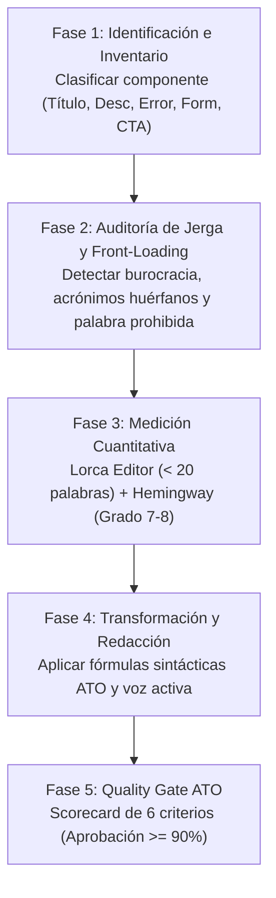

# Metodología de UX Writing y Content Design - Portal SAT Guatemala
## Adaptación Oficial del Estándar ATO (Australian Taxation Office) y Australian Government Style Manual

---

## 1. Fundamentos y Marco de Referencia Internacional

La Superintendencia de Administración Tributaria (SAT) adopta la metodología de **Content Design y Plain Language** del **Australian Taxation Office (ATO)** y del **Australian Government Style Manual**, adaptada al marco tributario y aduanero guatemalteco.

La premisa rectora del ATO es contundente:
> *"La administración tributaria no debe exigir que el ciudadano sea abogado ni contador para entender sus obligaciones. El lenguaje claro no simplifica la ley: traduce la complejidad técnica a instrucciones ejecutables sin perder certeza jurídica."*

Esta metodología se fundamenta en los siguientes recursos oficiales abiertos:
- **ATO Design System - Content Guidelines:** [`designsystem.ato.gov.au`](https://designsystem.ato.gov.au/) — Pautas para botones, formularios, alertas, tarjetas y flujos de error.
- **Australian Government Style Manual:** [`stylemanual.gov.au`](https://www.stylemanual.gov.au/) — Estándar de oraciones cortas, voz activa, accesibilidad y diseño centrado en el usuario.
- **ATO Plain Language Manual:** Guía de traducción de legislación fiscal a instrucciones ciudadanas.
- **Content Design London - Readability Guidelines:** [`readabilityguidelines.co.uk`](https://readabilityguidelines.co.uk/) — Evidencia basada en pruebas de usuario sobre escaneabilidad y microcopy.

---

## 2. Los Tres Pilares ATO Adaptados al Ecosistema SAT

```
┌───────────────────────────────────────────────────────────────────────────┐
│                    METODOLOGÍA CONTENT DESIGN ATO-SAT                     │
├─────────────────────┬───────────────────────┬─────────────────────────────┤
│      PILAR 1        │        PILAR 2        │           PILAR 3           │
│   DESMANTELAR LA    │     ESTRUCTURA        │    MICROCOPY CONVERSACIONAL │
│    JERGA LEGAL      │    FRONT-LOADING      │     Y FORMULARIOS ACTIVOS   │
├─────────────────────┼───────────────────────┼─────────────────────────────┤
│ Traducir artículos  │ Lo esencial en las    │ Tratar al ciudadano en      │
│ y leyes a acciones  │ primeras 3 palabras.  │ 2.ª persona ("tú"/"usted"). │
│ ciudadanas. La base │ Oraciones < 20 pal.   │ Errores con causa humana y  │
│ legal va colapsada. │ Chunks de 3 a 5 items.│ pasos de resolución claros. │
└─────────────────────┴───────────────────────┴─────────────────────────────┘
```

### Pilar 1: Desmantelar la Jerga Legal sin Perder Rigor Jurídico
- **Separación de capas:** La interfaz pública (título, descripción, tarjetas, pasos) utiliza **100% lenguaje ciudadano cotidiano**. Las referencias a decretos, leyes y acuerdos se trasladan a una sección secundaria colapsable denominada *"Base Legal y Normativa Asociada"*.
- **Traducción de tecnicismos burocráticos:** Ningún título o descripción debe incluir términos como *"sujeto pasivo"*, *"hecho generador"*, *"afección tributaria"*, *"procedimiento de mérito"* o *"omiso"*.
- **Equivalencias inmediatas:**
  - *Sujeto pasivo con actividad mercantil* ➔ **Personas o empresas con negocio**.
  - *Acreditación de distintivos del Registro Fiscal de Vehículos* ➔ **Tarjeta de circulación y calcomanía**.
  - *Deducción por depreciación de activos fijos* ➔ **Descuento por pérdida de valor de tus equipos o herramientas**.

### Pilar 2: Estructura Front-Loading y Fragmentación Visual (Visual Chunking)
- **Regla de los 3 primeros términos:** El usuario escanea en patrón "F". La intención principal, el verbo de acción o la palabra clave deben situarse en las primeras 3 palabras del título o botón.
  - ❌ *Información sobre los requisitos indispensables para solicitar la inscripción del NIT*
  - ✅ **Solicitar mi NIT en línea**
- **Regla de oraciones cortas:** Máximo **20 palabras por oración**. Párrafos de máximo 2 a 3 oraciones.
- **División visual de requisitos:** Prohibido redactar requisitos o pasos en bloques de texto continuo. Se estructuran siempre en listas viñetadas con verbos directos al inicio de cada punto.

### Pilar 3: Microcopy Conversacional, Preguntas Directas y Voz Activa
- **Voz activa obligatoria:** Debe quedar explícito quién ejecuta la acción.
  - ❌ *La solicitud deberá ser presentada por el contribuyente antes del vencimiento.* (Voz pasiva burocrática).
  - ✅ **Envía tu solicitud antes de la fecha límite.** (Voz activa directa).
- **Formularios como diálogo humano:** Los campos de formulario sustituyen las etiquetas abstractas de bases de datos por preguntas amigables.
  - ❌ *Razón Social* ➔ ✅ **¿Cuál es el nombre de tu empresa?**
  - ❌ *Domicilio Fiscal Notificable* ➔ ✅ **¿Dónde debemos enviarte las notificaciones?**
  - ❌ *Período de Imposición Afecto* ➔ ✅ **¿Qué mes o año vas a declarar?**

---

## 3. Normativa Institucional Vinculante (SAT Guatemala)

Esta metodología se articula estrictamente con las reglas maestras del proyecto:
1. **Regla 10 (Plain Language y Acrónimos):** Todo acrónimo debe expandirse en su primera mención con formato `Significado Completo (SIGLA)`. Ejemplo: `Registro Tributario Unificado (RTU)`.
2. **Regla 12 (Prohibición Absoluta de "Trámite"):** Uso estricto y exclusivo del término **"gestión" / "gestiones"**. Queda prohibido usar *"trámite"* en títulos, descripciones, contadores, botones o textos de ayuda.
3. **Regla 13 (Cero Modales ni Popovers):** Toda ficha de gestión debe abrirse en su propia **página completa dedicada** con URL canónica `#/gestion/:id`.
4. **Diseño de Tarjetas Compactas:** Sin íconos decorativos parásitos, sin conteos (`4 gestiones`), toda la tarjeta clickeable con hover institucional sólido y texto interior contrastado.

---

## 4. Protocolo de Revisión Paso a Paso (5 Fases de Ejecución)



### Fase 1: Identificación e Inventario del Componente
Identificar el tipo de texto y su rol en la interfaz:
1. **Título de Gestión (H1 / Tarjeta):** Máximo 8 a 10 palabras. Verbo en infinitivo o sustantivo de acción.
2. **Descripción de Tarjeta / Meta:** Máximo 2 oraciones (Fórmula: 1. Qué es o para qué sirve + 2. Qué beneficio o requisito clave tiene).
3. **Mensaje de Error / Estado:** Encabezado + causa humana + qué hacer (pasos resolutivos).
4. **Etiqueta de Formulario (Label):** Pregunta conversacional o instrucción concisa.
5. **Botón de Acción (CTA):** Verbo + objeto claro (ej. *"Descargar calcomanía"*, *"Enviar declaración"*).

### Fase 2: Auditoría de Jerga, Acrónimos y Front-Loading
Verificar la presencia de barreras cognitivas:
- [ ] ¿Aparece la palabra prohibida *"trámite"* o *"trámites"*? (Si aparece, sustituir de inmediato por *"gestión"*).
- [ ] ¿Hay siglas sin expandir? (ej. solo *FEL*, solo *DUCA*, solo *ISCV*).
- [ ] ¿Inicia el título con palabras de relleno como *"Información de..."*, *"Requisitos para la..."*, *"En relación con..."*?
- [ ] ¿Las 3 primeras palabras indican claramente la acción y el tema?

### Fase 3: Medición Cuantitativa de Legibilidad
Someter el texto a las herramientas oficiales de evaluación:
1. **Lorca Editor ([`lorcaeditor.com`](https://lorcaeditor.com/)):**
   - Verificar que ninguna oración supere las **20 palabras**.
   - Reducir o eliminar adverbios en *-mente* y frases de enlace burocráticas (*"por cuanto"*, *"asimismo"*, *"en virtud de"*).
2. **Hemingway App ([`hemingwayapp.com`](https://hemingwayapp.com/)):**
   - Nivel de lectura meta: **Grade 7 a Grade 8** (comprensible para cualquier ciudadano con educación básica).
   - Eliminar oraciones resaltadas en rojo (*very hard to read*).
3. **Prueba de Flesch-Szigriszt (Español):** Índice superior a **65 puntos** (estándar de texto claro y accesible).

### Fase 4: Transformación y Redacción Conversacional
Aplicar las fórmulas sintácticas aprobadas:

#### A. Fórmula para Títulos de Gestión
$$\text{[Verbo en Infinitivo o Sustantivo de Acción]} + \text{[Objeto o Servicio]} + \text{[Acrónimo Oficial Expandido (si aplica)]}$$
*Ejemplo:* `Inscribir vehículo nuevo importado` | `Solicitar Solvencia Fiscal en Línea`

#### B. Fórmula para Descripciones de Ficha / Tarjeta (Máx. 2 oraciones)
$$\text{Oración 1: Propósito directo} + \text{Oración 2: Qué necesitas o qué obtienes}$$
*Ejemplo:* `Consulta si tu empresa tiene declaraciones o pagos pendientes con la SAT. Solo necesitas ingresar tu Número de Identificación Tributaria (NIT) y contraseña de Agencia Virtual.`

#### C. Fórmula ATO para Mensajes de Error (Patrón de 3 Partes)
1. **Título del Error:** Qué ocurrió en lenguaje humano (sin códigos de sistema como *"Error 500"* o *"ORA-01403"*).
2. **Causa Clara:** Explicación en 1 oración de por qué se detuvo el proceso.
3. **Qué hacer (Acción Resolutiva):** Viñetas ordenadas con la solución exacta.

### Fase 5: Validación con el Scorecard ATO (Quality Gate)
Todo texto debe evaluarse contra la matriz de autoevaluación antes de publicarse en producción.

---

## 5. Matriz de Autoevaluación al Estilo ATO (Scorecard de Calidad)

| Criterio | Pregunta de Control | Estándar Obligatorio | Puntos |
| :--- | :--- | :--- | :---: |
| **1. Front-loading** | ¿La acción principal o palabra clave está en las primeras 3 palabras? | Sí: acción visible de inmediato | **20** |
| **2. Voz Activa** | ¿Está claro quién hace qué? (ej. "Envía tu formulario" vs "El formulario se envía") | Sí: segunda persona singular clara | **20** |
| **3. Legibilidad** | ¿Las oraciones tienen menos de 20 palabras y lectura Grade 7-8? | Sí: verificado en Lorca / Hemingway | **20** |
| **4. Acción Clara** | ¿El botón o microcopy indica con exactitud qué pasa al hacer clic? | Sí: verbo + destino explícito | **15** |
| **5. Cero Burocracia** | ¿Está libre de jerga legal ("sujeto pasivo", "hecho generador") y base legal colapsada? | Sí: lenguaje cotidiano 100% | **15** |
| **6. Cumplimiento SAT** | ¿Respeta la Regla 12 (Cero "trámite") y acrónimos expandidos en primera mención? | Sí: cero violaciones | **10** |
| **TOTAL** | **Calificación de Calidad Lingüística** | **Mínimo Aprobatorio: 90 pts** | **/100** |

---

## 6. Casos Prácticos de Transformación SAT Guatemala (Antes vs. Después)

### Caso 1: Títulos Largos y Burocráticos del Catálogo SAT
| ID | ❌ Título Original (Burocrático / 24–30 palabras) | ✅ Título Estándar ATO (Acción Front-loaded / 5–8 palabras) | Beneficio Ciudadano |
| :--- | :--- | :--- | :--- |
| `SAT-GES-0362` | Despacho de distintivos de control de productos importados a los fabricantes o importadores domiciliados en el país y a las personas individuales y jurídicas que no sean fabricantes ni importadores (30 palabras) | **Solicitar distintivos de control para productos importados** (7 palabras) | Elimina enumeración redundante de sujetos; la segmentación se explica dentro de la ficha. |
| `SAT-GES-0125` | Inscripción de NIT Administrativo Jurídico para Entidad Extranjera para la Adquisición de bien Inmueble o mueble (Vehículo terrestre, marítimo o aéreo) empresa/organización (Persona Jurídica) (24 palabras) | **Inscribir NIT de empresa extranjera para comprar bienes** (8 palabras) | Escaneo instantáneo; el detalle de vehículos y tipos de bienes va en requisitos. |
| `SAT-GES-0136` | Devolución o Compensación de Retenciones del Impuesto Sobre la Renta (ISR) Retenido a Personas Residentes y no Residentes con Establecimiento Prmanente SAT-1331 (22 palabras) | **Solicitar devolución de retenciones de ISR (Formulario SAT-1331)** (8 palabras) | Acción directa en primera palabra; identifica de inmediato el formulario. |
| `SAT-GES-0021` | Actualización de Cambio de Régimen de Pequeño Contribuyente a Régimen Electrónico de Pequeño Contribuyente (14 palabras) | **Cambiar al Régimen Electrónico de Pequeño Contribuyente** (7 palabras) | Sustituye el sustantivo administrativo *"Actualización de Cambio"* por el verbo de acción *"Cambiar"*. |

---

### Caso 2: Reingeniería de Mensajes de Error de Sistemas SAT (Declaraguate / Agencia Virtual)

#### Escenario: Error al validar NIT en formulario de Declaraguate
- ❌ **Antes (Mensaje tradicional de sistema / Código crudo):**
  > *Error 104: Validación de NIT fallida. El Número de Identificación Tributaria ingresado se encuentra en estado administrativo NO VIGENTE o BLOQUEADO por la Sección de Gestión y Cobro. Acuda a la oficina tributaria.*
- 🔍 **Diagnóstico Metodológico ATO:**
  1. *Identificar la causa:* El NIT está suspendido o tiene omisos pendientes de aclaración.
  2. *Eliminar el código:* Quitar "Error 104" y términos amenazantes como "bloqueado por cobro".
  3. *Ofrecer solución ejecutable:* Indicar dónde verificar el estado y cómo reactivarlo.
- ✅ **Después (Estándar ATO - Lenguaje Claro y Orientado a la Acción):**
  > ### Revisa el estado de tu NIT
  > Tu Número de Identificación Tributaria (NIT) no está activo para presentar esta declaración.
  >
  > **Qué debes hacer:**
  > 1. Ingresa a tu **Agencia Virtual** y consulta si tienes declaraciones pendientes en el módulo de omisos.
  > 2. Si necesitas reactivarlo, actualiza tus datos en el **Registro Tributario Unificado (RTU) Digital**.
  > 3. Si tienes dudas, comunícate al centro de atención telefónica **1550**.

---

### Caso 3: Campos de Formularios Interactivos (Etiquetas Abstractas vs. Conversación)
| Campo Tradicional (Base de Datos) | Estándar ATO (Pregunta Conversacional Directa) | Texto de Ayuda Contextual (Placeholder / Helper) |
| :--- | :--- | :--- |
| *Régimen de Afiliación del IVA* | **¿Cómo vas a emitir tus facturas?** | Elige si vas a facturar como Pequeño Contribuyente (5%) o Régimen General (12%). |
| *Domicilio Fiscal* | **¿Dónde se encuentra tu casa o negocio principal?** | Escribe la dirección donde recibes correspondencia oficial. |
| *Placa de Circulación y VIN* | **¿Cuál es el número de placa y chasis de tu vehículo?** | Los encuentras en la parte delantera de tu tarjeta de circulación. |
| *Número de Documento de Identificación* | **Ingresa tu número de DPI** | 13 dígitos del Código Único de Identificación (CUI) de tu DPI. |

---

### Caso 4: Requisitos y Documentación (Párrafo Denso vs. Visual Chunking)
- ❌ **Antes (Párrafo burocrático denso):**
  > *Para dar inicio a la tramitación del cambio de uso de placas, el contribuyente titular del vehículo automotor deberá apersonarse con el documento de propiedad debidamente endosado, solvencia municipal y de tránsito vigentes, fotocopia del documento personal de identificación y la constancia de pago de la tarifa establecida en el acuerdo respectivo debidamente certificada por el banco.*
- ✅ **Después (Estructura ATO en Chunks Legibles):**
  > ### Qué necesitas para cambiar el uso de tus placas:
  > - **Certificado de propiedad del vehículo** (firmado por el propietario anterior).
  > - **DPI vigente** (Código Único de Identificación) del propietario.
  > - **Estar al día en tus impuestos:** Sin multas de tránsito pendientes ni omisos en SAT.
  > - **Comprobante de pago:** Boleta SAT-8933 cancelada en el banco.

---

## 7. Herramientas y Recursos de Trabajo Recomendados

1. **Evaluación de Textos en Español:**
   - **Lorca Editor:** [`lorcaeditor.com`](https://lorcaeditor.com/) — Análisis de legibilidad en español, conteo de palabras por oración y alerta de muletillas burocráticas.
2. **Evaluación de Estructura y Voz:**
   - **Hemingway App:** [`hemingwayapp.com`](https://hemingwayapp.com/) — Control de grado de lectura escolar (Grade 7-8) y detección de voz pasiva.
3. **Guías Oficiales de Consulta Permanente:**
   - **ATO Design System:** [`designsystem.ato.gov.au`](https://designsystem.ato.gov.au/) — Patrones de componentes tributarios.
   - **Australian Style Manual:** [`stylemanual.gov.au`](https://www.stylemanual.gov.au/) — Reglas de redacción accesible y front-loading.
   - **Content Design London:** [`readabilityguidelines.co.uk`](https://readabilityguidelines.co.uk/) — Guía empírica de legibilidad.
4. **Script de Auditoría Automatizada SAT:**
   - `scripts/audit_ux_writing_ato.py` — Ejecutar periódicamente para detectar títulos extensos, acrónimos huérfanos o desviaciones de la Regla 12.
